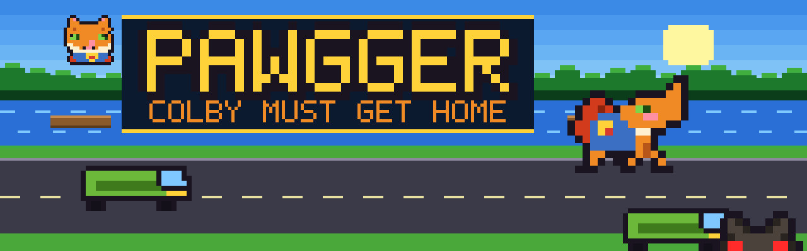

<p align="center"></p>

# Pawgger

[](https://bsommers.github.io/pawgger2/play/)
[](https://bsommers.github.io/pawgger2/)
[](#quick-start)

A blocky 8-bit parody of Frogger. Colby (SuperColby, an orange tabby) must hop across Perring Parkway Pete's road and a jungle river into five home bays. Zero assets, zero dependencies: all art is drawn in code and all sound is synthesised.

- **Play:** https://bsommers.github.io/pawgger2/play/
- **Site:** https://bsommers.github.io/pawgger2/
- **How to play:** [docs/HOW-TO-PLAY.md](docs/HOW-TO-PLAY.md)
- **How it was made:** [docs/HOW-IT-WAS-MADE.md](docs/HOW-IT-WAS-MADE.md)

## Quick start

Requires Node.js 20 or later. No install step.

```sh
npm start                  # serves the game at http://localhost:4871
npm test                   # node:test suite, 277 tests (2 skip by design)
node tools/validate-level.mjs --levels 12 --seeds 8   # level fairness validator
node tools/botplay.mjs --levels 12 --seeds 4          # autopilot soak, clears all 12 levels
node tools/build-web.mjs   # writes dist/pawgger2.html, one self-contained file
```

Open `dist/pawgger2.html` directly in a browser to play the single-file build.

## Layout

| Path | What it is |
|---|---|
| `index.html`, `style.css`, `src/` | The game (plain ES modules) |
| `src/core/defs.js` | Canonical constants, tuning and scoring |
| `src/sim/`, `src/levels/` | Simulation, Pete, level generation |
| `src/art/`, `src/audio/` | Code-drawn sprites and synthesised audio |
| `src/render/`, `src/ui/` | Renderer, HUD, menus and input |
| `test/` | Tests |
| `tools/` | Dev tools: serve, screenshots, build, bot play, audio export |
| `docs/site/` | GitHub Pages showcase site |
| `assets/brand/` | Logo, hero banner, icon and favicon set (SVG source plus PNG/ICO) |
| `ARCHITECTURE.md` | The binding design contract |

## Controls

Arrow keys or WASD to hop, Space or Enter to confirm, P to pause, M to mute, C for the CRT filter, F for fullscreen, H for help. Touch screens get on-screen hop buttons (they appear on the first touch).

## Levels and storage

12 levels are tuned and verified fair; the sky cycles day, golden hour, dusk, night every five levels and speeds are capped after that. Hi-scores and settings persist in `localStorage` under `pawgger2.hi` and `pawgger2.settings` (namespaced so they do not collide with other games on the same github.io origin).

## Publishing

`.github/workflows/pages.yml` builds the single-file game and publishes the site to GitHub Pages: the site at `/` and the game at `/play/`. Brand assets are copied to `/brand/`.
